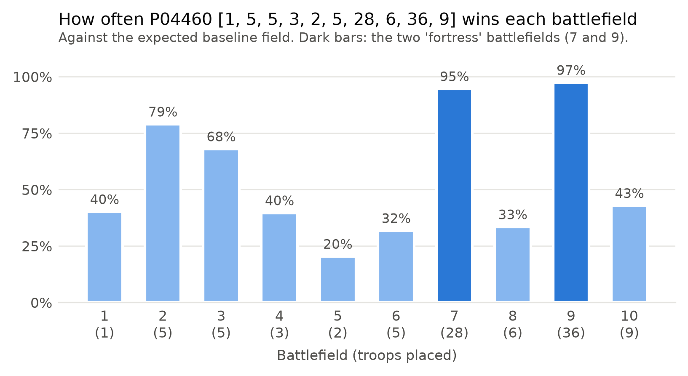
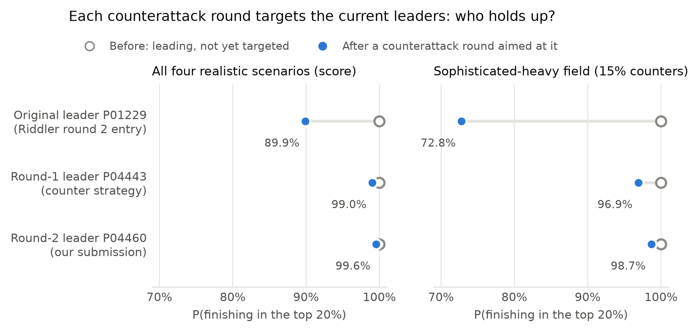

# Modified Colonel Blotto Simulation

A simulation for choosing one troop allocation in Maroon Capital's Fall 2026 challenge
problem, a Colonel Blotto game with bonus scoring rules. Instead of searching for a
strategy that beats everyone (none exists in Blotto), it estimates how often each
candidate would finish in the **top 20%** of a realistic field of applicants, and picks
the one that does so most consistently.

**Submitted allocation:** `[1, 5, 5, 3, 2, 5, 28, 6, 36, 9]`. It finished in the top 20%
of 99.7% of simulated contests across four field scenarios.

## The game

- Distribute 100 troops over 10 battlefields worth 1–10 points (10 non-negative integers
  summing to 100).
- Every entry plays every other entry. On each battlefield, strictly more troops wins;
  equal troops means nobody wins it.
- **Base score:** the sum of the values of the battlefields you won.
- **Rule 1 (adjacency):** each won battlefield next to another won battlefield counts
  1.5×. A run of consecutive wins gets 1.5× on every battlefield in the run, once each.
- **Rule 2 (multiple of 5):** if the base score is a multiple of 5, the score is
  multiplied by 1.4.
- **Rule 3 (battlefield 6):** if you won battlefield 6, the score is multiplied by 1.1.
- Bonuses apply in that order. The higher score wins the match; equal scores are a draw.

Examples: winning battlefields {3, 5, 6, 7} scores 33.0; winning all ten scores 127.05.

## Results

| Measure | Value |
|---|---|
| P(top 20%), weighted over four scenarios | **99.7%** |
| Baseline / sophisticated-heavy / AI-heavy / naive-heavy | 99.9% / 98.9% / 100% / 100% |
| Ranked by total points instead of wins | 92.2% |
| Hold-out field (Riddler round 4, never used for selection) | 99.6% |
| Every one-troop change to the allocation | all within 10 points |
| Head-to-head win rate against the expected field | 80.6% |
| After a round of counter strategies built to beat it | 100% → 99.7% |

The allocation concentrates 64 troops on two "fortress" battlefields (7 and 9), which it
wins 95–97% of the time, and spreads small amounts elsewhere to pick up cheap
battlefields and adjacency bonuses.



Each leader was then targeted by a round of counter strategies. The original leader
dropped sharply; the submission held up best:



The main alternative was `[3, 5, 7, 3, 21, 8, 3, 7, 35, 8]` (99.3%, and stronger when
ranked by points). The submission was preferred because it is the stronger bet when wins
decide the ranking, does best against AI-generated answers, and had already survived a
counterattack aimed at it.

## How it works

### 1. Strategy pool

4,498 strategies (3,678 distinct allocations) from several sources, each standing in for
a type of applicant:

| Source | What it models |
|---|---|
| Hand-written rules (even split, proportional to value, stacking the top battlefields, …) | Low-effort entries |
| 30 AI answers: 10 each from Claude, ChatGPT, and Gemini, plus small variations | Applicants who ask a chatbot |
| FiveThirtyEight Riddler Blotto submissions, rounds 1–4 | Real human Blotto players |
| Riddler entries with one bonus-motivated adjustment | Players who notice the bonuses |
| Uniform random allocations | Noise |
| Counter strategies (step 5) | Applicants who try to beat the obvious strong answers |

Riddler round 4 is held out: it is in the pool but used only to check the finalists.

### 2. Every matchup

Each strategy plays every other once: 10,113,753 matchups. There are only 1,024 possible
sets of won battlefields, so their scores are precomputed in a lookup table. Scores are
stored as integers (score × 200) so that ties are exact, never a floating-point accident.

### 3. Shortlist

The 2,948 distinct eligible candidates are narrowed to 191 using:
- round-robin win rate, with opponents weighted so each source counts equally (top 100);
- iterated elimination: cut the bottom half and re-rank the survivors (top 100 by rounds
  survived);
- the top 5 from every source, so no source is crowded out.

An exact Nash equilibrium of the pool (linear program, 175 strategies in its support) is
computed for reference.

### 4. Simulated contests

A contest samples 100–225 opponents according to a field scenario, adds the candidate,
plays everyone against everyone, and ranks all players by wins. Four scenarios cover the
uncertainty about who applies:

| Scenario | Assumption | Weight |
|---|---|---|
| Baseline | Best guess: about 40% AI-assisted, 20% experienced Blotto players | 40 |
| Sophisticated-heavy | Strong humans, strong AI answers, many counter strategies | 24 |
| AI-heavy | Most applicants submit a chatbot's answer | 19 |
| Naive-heavy | Half the field uses simple rules | 7 |

Group shares are randomized in every contest, and all candidates face the same sampled
fields. Each shortlisted candidate plays 8,000 contests; the top 10 are re-run on a
fresh seed with 40,000 each and checked against the hold-out field, ranking by points,
draws counted as losses, and all ~90 one-troop neighbors. The selection rule, including
the 50% flag on any failed check and the tiebreakers, was fixed before seeing results.

### 5. Counterattack

A local search builds 20 strategies per round that maximize win rate against the current
top 10 and the expected field. They join the pool and steps 2–4 re-run. Each new round
took the lead, because nothing had yet been built to beat it, so the third round was made
opponent-only: the final pick had to survive a counterattack aimed at it.

## Repository layout

```
scoring.py          reference scoring rules (everything else is checked against it)
pool.py             step 1: build the strategy pool        -> cache/pool.csv
matrix.py           step 2: lookup table and all matchups  -> cache/matrix_*.npz
rankings.py         step 3: round robin, elimination, Nash, shortlist -> results/rankings_*
robustness.py       step 4: simulated contests and selection rule     -> results/robustness_*
counterattack.py    step 5: counter strategies             -> data/counter/round_N.csv
analysis/           lookup-table analysis, battlefield analysis, figures
examples/           a small standalone walkthrough with three strategies
tests/              pytest suite
data/               AI answers, Riddler data, generated counter strategies
results/            committed outputs (CSV and figures)
cache/              regenerable pool and matrices (not committed)
```

`CLAUDE.md` holds the full specification and a dated log of design decisions.

## Reproducing the results

Requires Python 3 and [uv](https://github.com/astral-sh/uv) (or any virtual environment
with the same packages).

```bash
uv venv
uv pip install numpy pandas matplotlib scipy pytest

.venv/bin/python pool.py
.venv/bin/python matrix.py
.venv/bin/python rankings.py
.venv/bin/python robustness.py
```

Each step takes under a minute on a laptop. All randomness is seeded and the seeds are
saved in the metadata files (`cache/pool_meta.json`, `results/*_meta.json`). The counter
strategies are committed in `data/counter/`, so the pipeline rebuilds the final pool
without re-running the search; `counterattack.py` refuses to run a fourth round.

Optional analysis:

```bash
.venv/bin/python analysis/lut_analysis.py    # which won-sets score what
.venv/bin/python analysis/pick_analysis.py   # battlefield-by-battlefield breakdown
.venv/bin/python analysis/figures.py         # the two figures above
```

## Tests

```bash
.venv/bin/python -m pytest
```

181 tests. Among other things they check the scoring rules against hand-worked
examples, that the lookup table matches the scorer for all 1,024 won-sets, that the
matchup matrices agree with direct scoring and satisfy their symmetry invariants, and that
pool IDs stay stable as sources are added.

## Key outputs

| File | Contents |
|---|---|
| `results/robustness_final.csv` | Top 10 finalists with every check and the final ranking |
| `results/robustness_selection.csv` | All shortlisted candidates, selection run |
| `results/robustness_neighbors.csv` | One-troop neighbors of each finalist |
| `results/rankings_shortlist.csv` | The shortlist and why each strategy is on it |
| `results/rankings_nash.csv` | Nash equilibrium of the pool |
| `results/pick_analysis_*.csv` | Per-battlefield and per-opponent breakdowns |
| `results/lut_*.csv` | Scores of every won-set |

## Credits

- Riddler data: FiveThirtyEight,
  [`riddler-castles`](https://github.com/fivethirtyeight/data/tree/master/riddler-castles),
  licensed under [CC BY 4.0](https://creativecommons.org/licenses/by/4.0/).
- The challenge problem is Maroon Capital's; the rules above are a summary.
- The AI strategies were collected by asking Claude, ChatGPT, and Gemini to solve the
  problem. The code was written with the help of Claude Code.

## License

Code: MIT (see `LICENSE`). Data in `data/riddler/` remains under its original CC BY 4.0
license.
